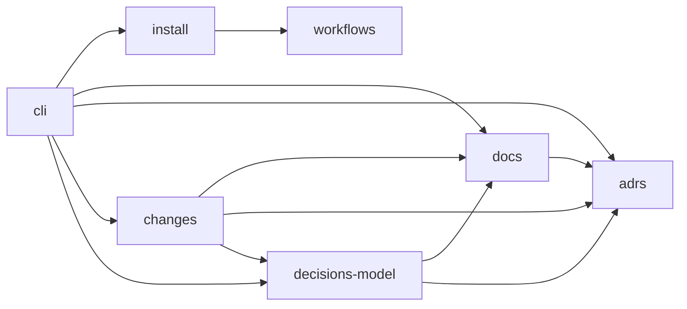

# Architecture

## Overview
lore is a single static Go binary plus a set of agent workflows it installs into a project. The binary does the mechanical work — scaffolding, parsing and checking the docs, ADR statuses, change bookkeeping, the archive gate, calls to the decisions model. The agent (Claude Code) does the writing by following the workflows; the owner approves at the gates.

Everything lives in plain files in the project repo: `lore.yaml` at the root, the docs folder (`lore/` by default), and the agent wiring (`AGENTS.md`, `CLAUDE.md`, `.claude/`). There is no database and no cache — every command re-reads the files it needs.

## Zones and dependencies

- **cli → everyone:** finds the project (`lore.yaml`), parses commands and flags, calls the zone that owns the action, prints issues and sets the exit code.
- **install → workflows:** copies the embedded workflows and prompts into `lore/`, links workflows as Claude Code skills, renders the `AGENTS.md` block from the workflow list.
- **changes → docs:** deltas are checked against the current zone docs before the merge and verified line by line after it.
- **changes → adrs:** ADR drafts inside a change are validated with the ADR rules and moved into `adr/` at archive, superseding what they replace.
- **changes → decisions-model:** `change status` asks for knowledge relevant to the next task; `change check` asks which zones a fact touches and which accepted ADRs it may contradict.
- **decisions-model → docs, adrs:** candidates for selection are zones (judged by their tldr, invariants, boundaries and contracts; printed whole) and accepted ADRs.
- **docs → adrs:** `lore show` prints a zone with the ADRs that apply to it (own and `global`).
- **workflows** depend on the CLI only through its commands; the CLI never reads workflow content except to list workflow names.

## Key technologies
- Go 1.23, one dependency: `gopkg.in/yaml.v3`. Markdown (frontmatter, headings, sections) is parsed by hand.
- Templates, workflows, prompts, the default `lore.yaml` and the `AGENTS.md` block are embedded into the binary (`internal/assets/files/`).
- Decisions model: OpenRouter Decisions API, default model `perplexity/pplx-decider-v1.2`. Optional — everything except `lore ctx`, `change check` and the model part of `change status` works without a key.
- `git` is called for `change new --from-diff` and to list project files for the code-anchor check (falls back to a directory walk outside git).
- Built with a Nix flake (`nix build`, `nix profile install`) or plain `go build`.
- Claude Code is the only supported agent: `.claude/settings.json` permissions, `.claude/skills/` symlinks, `@AGENTS.md` in `CLAUDE.md`.

## Conventions
- All lore docs, workflows and model prompts are in English. `design.md` (the design and decision log, in Russian) is for the owner and is not part of lore.
- Per-machine state lives inside the docs folder in `lore/.local/` and `lore/.env`, both gitignored; nothing local is written anywhere else in the project.
- Commands are idempotent where they set things up (`init`, `upgrade`, `agents sync`) and never overwrite owner edits silently.
- Anything that talks to the decisions model must degrade gracefully: a missing key or a timeout fails only the commands that need the model (`lore ctx`, `change check`); `change status` still shows everything else.
- Code layout: `cmd/lore/` — commands and flag parsing; `internal/lore/` — all logic; `internal/assets/files/` — embedded files.
